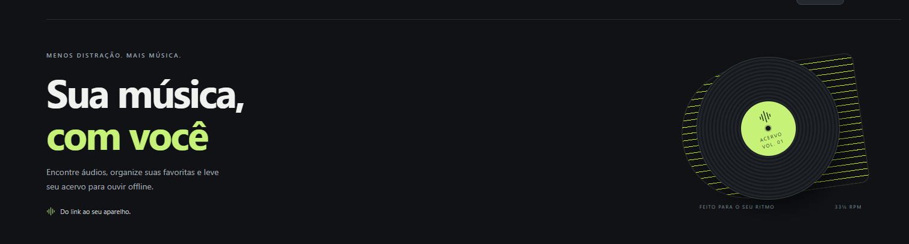

# Acervo for Windows

## Download for Windows

Open [Releases](https://github.com/yonosan/Acervo/releases) and download **Acervo-Windows-1.9.0.zip**. Extract the entire ZIP, then open **Acervo.exe**. Keep the **_internal** folder next to the executable. Windows 10/11 x64 and Microsoft Edge WebView2 are required.

English is the default. To switch to Brazilian Portuguese, open **Settings → Language**. To update, exit the previous version first and preserve your **Dados** folder and downloaded media.

The corresponding application and third-party sources are in **Acervo-Fontes-1.9.0.zip**. The repository contains source code; the Windows executable is distributed separately in Releases.

## Idiomas / Languages

English is the default interface language. To change it, open **Settings → Language**, select **English** or **Português (Brasil)**, then choose **Save settings**. The window reloads and the choice is kept when the app reopens.

O inglês é o idioma padrão. Para usar português, abra **Settings → Language**, escolha **Português (Brasil)** e clique em **Save settings**. A escolha permanece ao reabrir. Títulos, artistas, álbuns, arquivos e os estados internos das tarefas mantêm seus dados originais. Diálogos do Windows e páginas de serviços externos podem seguir o idioma próprio desses serviços.



Aplicativo pessoal para pesquisar e salvar mídia própria ou autorizada, com inglês por padrão e português disponível nas configurações. Versão 1.9.0.

## Recursos implementados

- Pesquisa por música e artista; análise de links de áudio HTTPS e playlists públicas do YouTube com yt-dlp.
- Botões MP3/MP4, progresso real, cancelamento, fila, histórico e player local.
- Capas e metadados quando disponíveis, seleção e movimentação de pastas.
- Revisão de correspondências e opção explícita de baixar sem revisar.
- Leitura experimental de metadados de Músicas Curtidas pela página do Spotify, após login manual. Não extrai áudio do Spotify.
- Bandeja do Windows: mantém downloads em segundo plano e reduz atividades da interface quando recolhida.

## Executar pelo código

Requer Windows 10/11 de 64 bits, Python 3.11, FFmpeg (incluindo ffprobe), Node.js e Microsoft Edge WebView2. FFmpeg, ffprobe e Node devem estar no PATH. Para a janela de conexão com Spotify, requer Edge ou Chrome instalado. Estas ferramentas não estão incluídas neste repositório.

No PowerShell, dentro desta pasta:

```powershell
py -3.11 -m venv .venv
.\.venv\Scripts\python.exe -m pip install -r requirements.txt
.\.venv\Scripts\python.exe desktop.py
```

O aplicativo inicia sua comunicação interna em 127.0.0.1, com porta aleatória e acesso temporário. Não é necessário hospedar um servidor. Abrir apenas static/index.html não executa as funções de pesquisa e download.

O X e minimizar recolhem para a bandeja. Para encerrar, use **Sair do Acervo**. Downloads exigem PC ligado, sem suspensão e com internet. O modo econômico não garante consumo zero. A preferência de segundo plano fica em Configurações.

## Testes

Instale as dependências de desenvolvimento e execute:

```powershell
.\.venv\Scripts\python.exe -m pip install -r requirements-build.txt
New-Item -ItemType Directory -Force work | Out-Null
.\.venv\Scripts\python.exe -m unittest discover -s tests -p "test_*.py" -v
```

A suíte usa dados temporários e mídia sintética. FFmpeg precisa estar no PATH. O teste entre unidades pode ser ignorado quando não existirem duas unidades disponíveis. Veja TESTES.md para o resultado da preparação desta cópia.

## Limites e serviços externos

- Até duas transferências simultâneas, 5.000 tarefas pendentes e 100 MB/20 minutos por arquivo; playlists do YouTube limitadas a 500 itens por análise.
- YouTube pode recusar acesso ou mudar o funcionamento. Não há suporte a contornar DRM ou controles de acesso. Converter para MP3 não melhora a gravação original.
- O leitor do Spotify depende do layout do site e pode importar apenas parte da lista ou parar de funcionar. Playlists genéricas do Spotify por link não são suportadas. Os termos do Spotify restringem raspagem; login manual não equivale à autorização da plataforma para coleta automatizada.
- A autorização dos titulares do conteúdo e as regras da plataforma de origem devem ser consideradas separadamente. O projeto não é afiliado ao Spotify ou ao YouTube.
- O modo sem revisão pode escolher cover, remix ou outra gravação.

Manual detalhado: [MANUAL.md](MANUAL.md). Termos das fontes: [YouTube](https://www.youtube.com/static?template=terms&hl=pt&gl=BR) e [Spotify](https://www.spotify.com/br-pt/legal/user-guidelines/).

## Dados e publicação

Esta cópia não contém músicas, banco pessoal, histórico, logs de execução, cookies ou perfis de login. O uso do programa gera Dados e Músicas localmente. Não envie essas pastas para o GitHub. O .gitignore cobre os arquivos gerados conhecidos; revise qualquer arquivo novo antes de publicar.

As versões para Windows e seus códigos-fonte são disponibilizados na página de [Releases](https://github.com/yonosan/Acervo/releases). Extraia o ZIP inteiro e mantenha a pasta `_internal` junto do Acervo.exe. A compilação local está descrita em [BUILD.md](BUILD.md).

## Licenciamento

O código do Acervo é distribuído sob a [GNU GPL versão 3](LICENSE). Você pode usar, modificar e redistribuir conforme essa licença, inclusive comercialmente. Ao distribuir versões cobertas, disponibilize o código-fonte correspondente e preserve os avisos. As dependências conservam suas próprias licenças; veja [THIRD_PARTY_NOTICES.md](THIRD_PARTY_NOTICES.md) e [SOURCES.md](SOURCES.md).
